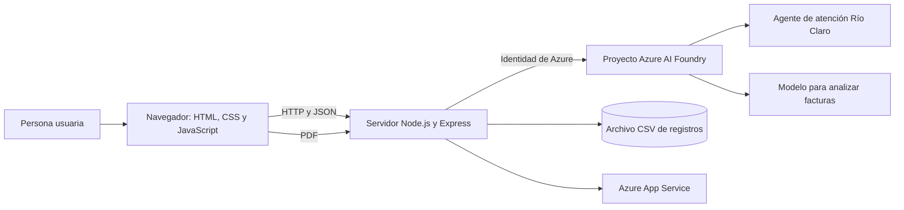

# Explicación del proyecto Río Claro AI

## Datos del proyecto

- **Integrante:** Jose Andres Moo Aban
- **Nombre del proyecto:** Río Claro AI
- **Tecnologías:** GitHub Copilot como apoyo al desarrollo; Microsoft Azure AI
  Foundry con el modelo `gpt-4.1-mini-1` y el agente configurado con sus fuentes
  de conocimiento; Node.js, Express y Azure App Service.
- **Demo pública:** <https://rio-claro-practica-77486.azurewebsites.net/>
- **Repositorio GitHub:** <https://github.com/andrres1210/rio-proyecto>
- **Descripción:** Se desarrolló Río Claro AI, un portal web de demostración
  para atención al cliente y gestión básica de facturas. Su asistente responde
  preguntas sobre productos, políticas y procesos con base en el conocimiento
  configurado en Azure AI Foundry. También permite analizar facturas PDF,
  detectar posibles duplicados y registrar información digital para revisión
  humana.

## 1. ¿Qué es Río Claro AI?

Río Claro AI es un portal web de demostración para la atención a clientes y la
gestión básica de facturas. Integra un asistente virtual conectado a un agente
de Azure AI Foundry y herramientas para recibir facturas de proveedores,
registrar información de clientes y consultar registros por folio.

El proyecto busca mostrar cómo una interfaz web puede combinar funciones
tradicionales de una aplicación de negocio con servicios de inteligencia
artificial en la nube.

**Demo pública:** <https://rio-claro-practica-77486.azurewebsites.net/>

## 2. Objetivo

El objetivo es ofrecer una experiencia sencilla desde la que una persona pueda:

- Consultar al asistente sobre productos, políticas y procesos de Río Claro.
- Escribir una pregunta o dictarla por voz.
- Leer las respuestas del asistente en voz alta si lo desea.
- Enviar una factura en PDF para extraer sus datos y revisar posibles
  duplicados.
- Crear un registro digital interno para un cliente.
- Consultar una factura por su folio.

La aplicación es un prototipo académico. Sus registros y controles están
pensados para demostrar el flujo funcional, no para sustituir un sistema
contable, fiscal o empresarial de producción.

## 3. ¿Cómo funciona?

### Asistente virtual

1. La persona escribe una pregunta en el chat o utiliza el dictado si su
   navegador lo admite.
2. El navegador envía el mensaje al servidor mediante `POST /chat`.
3. El servidor usa la identidad configurada en Azure para conectarse al
   proyecto de Azure AI Foundry y consultar al agente.
4. La respuesta vuelve al navegador y se muestra en la conversación.
5. Si la persona elige “Leer respuesta”, el navegador utiliza la síntesis de
   voz disponible en el dispositivo.

El conocimiento y el comportamiento del asistente dependen del agente y de la
configuración de Azure AI Foundry. La lectura en voz alta se realiza en el
navegador; el dictado depende del soporte y los permisos de micrófono del
navegador.

### Recepción y análisis de una factura

1. La persona selecciona un archivo PDF de hasta 8 MB.
2. El servidor valida el archivo y lo envía temporalmente a Azure AI Foundry
   para analizarlo.
3. El modelo intenta extraer proveedor, RFC, folio, fecha, subtotal, IVA y
   total.
4. El servidor compara el proveedor, RFC y folio con los registros existentes
   para señalar una posible factura duplicada.
5. Si el análisis es válido y no se detecta duplicado, la factura se registra
   para revisión.
6. El servidor intenta eliminar tanto el archivo temporal local como el
   archivo temporal enviado al servicio de Foundry.

La extracción automática puede equivocarse y la detección de duplicados es una
ayuda, no una aprobación contable. Cuentas por Pagar debe revisar la factura
antes de cualquier decisión o pago.

### Registro digital de clientes

El formulario permite capturar el nombre o razón social, RFC y conceptos con
cantidades, precios e impuestos. El servidor valida los datos, calcula los
importes y asigna un folio.

Este flujo crea únicamente un **registro digital interno**. No genera un CFDI,
un comprobante fiscal ni un archivo de factura descargable.

### Consulta e historial

Los registros se almacenan en un archivo CSV dentro del directorio configurado
por `DATA_DIR`. La aplicación puede listar el historial y buscar un registro
por folio. En Azure, la demo utiliza almacenamiento asociado al App Service
para conservar el CSV fuera del directorio del código.

## 4. Arquitectura general



### Componentes

- **Interfaz web:** páginas HTML, estilos CSS y JavaScript para el inicio, el
  chat, las facturas y el panel administrativo.
- **Servidor:** aplicación Node.js con Express que publica los archivos web,
  valida las solicitudes, procesa los formularios y ofrece la API.
- **Azure AI Foundry:** hospeda el agente conversacional y permite analizar los
  documentos enviados.
- **Identidad:** `DefaultAzureCredential` permite usar credenciales de Azure
  CLI en desarrollo y la identidad administrada del App Service en Azure.
- **Almacenamiento:** archivo CSV configurable para los registros de la demo.
- **Azure App Service:** hospeda la versión pública del sitio.

## 5. Tecnologías utilizadas

| Tecnología | Uso |
|---|---|
| Node.js | Entorno de ejecución del servidor |
| Express | Servidor web y endpoints HTTP |
| HTML y CSS | Estructura y presentación del portal |
| JavaScript | Interacción del chat y formularios |
| Azure AI Foundry | Agente virtual y análisis de documentos |
| Azure Identity | Autenticación con credenciales de Azure |
| Multer | Recepción controlada de archivos PDF |
| CSV | Persistencia sencilla de registros para la práctica |
| Azure App Service | Publicación de la demo en la nube |

## 6. Endpoints principales

| Método | Endpoint | Función |
|---|---|---|
| `GET` | `/healthz` | Comprueba que el servidor está activo |
| `POST` | `/chat` | Envía una pregunta al agente |
| `POST` | `/subir-factura` | Analiza una factura PDF |
| `POST` | `/registrar-factura` | Crea un registro digital interno |
| `POST` | `/guardar-factura` | Guarda una factura analizada desde el panel |
| `GET` | `/historial` | Devuelve el historial de registros |
| `GET` | `/consultar-folio/:folio` | Busca un registro por folio |

## 7. Organización del código

```text
rio-proyecto/
├── public/
│   ├── index.html       # Inicio, servicios, preguntas frecuentes y ayuda
│   ├── chat.html        # Interfaz de conversación
│   ├── chat.js          # Chat, dictado y lectura en voz alta
│   ├── proveedor.html   # Formularios de facturación y consulta
│   ├── proveedor.js     # Lógica de formularios y cálculos
│   ├── admin.html       # Panel administrativo de demostración
│   ├── app.js           # Historial y métricas del panel
│   └── styles.css       # Estilos compartidos
├── server.js            # API, Azure AI Foundry y almacenamiento CSV
├── package.json         # Dependencias y comandos npm
├── package-lock.json    # Versiones resueltas de dependencias
├── .env.example         # Plantilla de configuración sin credenciales
└── README.md            # Presentación y guía de instalación
```

## 8. Ejecución local

### Requisitos

- Node.js 20, 21 o 22.
- Azure CLI y una cuenta con permisos sobre el proyecto de Azure AI Foundry, o
  cualquier otra credencial compatible con `DefaultAzureCredential`.
- El endpoint de un proyecto de Foundry y el nombre del agente.

### Pasos

1. Clona el repositorio e instala las dependencias:

   ```powershell
   git clone https://github.com/andrres1210/rio-proyecto.git
   cd rio-proyecto
   npm install
   ```

2. Copia la plantilla de variables:

   ```powershell
   Copy-Item .env.example .env
   ```

3. Edita `.env` con la configuración del proyecto:

   ```dotenv
   PROJECT_ENDPOINT=https://<recurso>.services.ai.azure.com/api/projects/<proyecto>
   AGENT_NAME=<nombre-del-agente>
   PORT=3000
   REQUIRE_ENTRA_AUTH=false
   ```

   `DATA_DIR` es opcional; si no se define, los datos se guardan en el
   directorio `data` local. El archivo `.env` contiene configuración local y no
   debe subirse a GitHub.

4. Inicia sesión en Azure y ejecuta el servidor:

   ```powershell
   az login
   npm start
   ```

5. Abre <http://localhost:3000/>.

## 9. Privacidad y alcance de la demo

La aplicación publicada es accesible sin iniciar sesión para que pueda ser
revisada como práctica académica. Quien la utiliza es responsable de los datos
que ingresa y de contar con autorización para compartirlos. Los registros
guardados en la demo pública pueden ser consultados por otras personas que
accedan al sitio.

Las cargas y conversaciones se procesan con servicios de Azure. No se deben
incluir credenciales, claves de API, archivos `.env` ni datos locales en el
repositorio. El proyecto excluye esos elementos mediante `.gitignore`.

La aplicación no está diseñada para producción. No reemplaza un sistema de
facturación fiscal, controles de acceso empresariales, respaldo formal,
auditoría contable ni una política de retención de datos.

## 10. Posibles mejoras futuras

- Incorporar autenticación y autorización por perfil.
- Reemplazar el CSV por una base de datos con controles de acceso.
- Añadir pruebas automatizadas para API y flujos de facturación.
- Añadir monitoreo, registros estructurados y alertas.
- Fortalecer la validación del contenido real de los archivos PDF.
- Definir reglas de retención y eliminación de datos para un uso real.

## Enlaces

- **Demo:** <https://rio-claro-practica-77486.azurewebsites.net/>
- **Repositorio:** <https://github.com/andrres1210/rio-proyecto>
