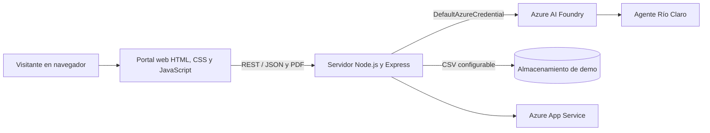

<div align="center">

# Río Claro AI

### Asistente virtual y portal de facturación con Azure AI Foundry

Portal web de demostración para atención al cliente y gestión de facturas,
desarrollado con Node.js, Express y un agente de Azure AI Foundry.

[](https://rio-claro-practica-77486.azurewebsites.net/)
[](https://nodejs.org/)
[](https://ai.azure.com/)

</div>

---

## Descripción

Río Claro AI reúne en una sola interfaz un asistente conversacional y
herramientas de demostración para recibir y consultar facturas. El asistente
responde en español a partir de la configuración y las fuentes de conocimiento
del agente de Foundry.

> **Proyecto académico:** la demo pública no requiere iniciar sesión. Cada
> visitante es responsable de la información que comparte y de contar con
> autorización para hacerlo. Los registros de facturación guardados pueden ser
> visibles para otras personas que accedan al sitio. No uses la demo como
> sistema de producción.

## Funcionalidades

### Asistente virtual

- Consulta al agente de Azure AI Foundry desde el navegador.
- Dictado por voz cuando el navegador lo admite.
- Lectura en voz alta opcional de las respuestas.
- Preguntas frecuentes, políticas y ayuda en la página principal.

### Facturación de demostración

- Recepción de facturas PDF de hasta 8 MB.
- Extracción de proveedor, RFC, folio, fecha e importes mediante el modelo.
- Detección de posibles coincidencias por proveedor y folio.
- Captura manual de registros digitales internos para clientes.
- Consulta por folio e historial de registros.

> La captura digital es un registro interno: no genera un CFDI ni un documento
> fiscal. La detección de duplicados no sustituye la revisión de Cuentas por
> Pagar.

## Arquitectura



El servidor usa `DefaultAzureCredential`: localmente puede autenticarse con
Azure CLI; en Azure puede usar la identidad administrada del App Service. No se
requiere una clave de API dentro del código.

## Tecnologías

| Componente | Tecnología |
|---|---|
| Servidor | Node.js 20–22, Express 5 |
| Agente y análisis | Azure AI Foundry, Azure AI Projects y Responses API |
| Identidad | Azure Identity (`DefaultAzureCredential`) |
| Interfaz | HTML, CSS y JavaScript |
| Recepción de PDF | Multer |
| Persistencia de demostración | CSV configurable por `DATA_DIR` |
| Despliegue de la demo | Azure App Service para Linux |

## Recorrido del proyecto

```text
rio-proyecto/
├── public/
│   ├── index.html       # Inicio, servicios, preguntas frecuentes y ayuda
│   ├── chat.html        # Interfaz del asistente
│   ├── chat.js          # Chat, dictado y lectura en voz alta
│   ├── proveedor.html   # Recepción y consulta de facturas
│   ├── proveedor.js     # Formularios de facturación
│   ├── admin.html       # Panel de administración de demostración
│   ├── app.js           # Historial y métricas del panel
│   └── styles.css       # Estilos compartidos
├── server.js            # API, Foundry, validación y almacenamiento CSV
├── package.json
├── .env.example         # Plantilla de configuración, sin secretos
└── README.md
```

## Ejecutar localmente

### Requisitos

- Node.js 20, 21 o 22.
- Un proyecto de Azure AI Foundry con un agente disponible.
- Azure CLI para la autenticación local, o credenciales accesibles mediante
  `DefaultAzureCredential`.

### Configuración

1. Clona el repositorio e instala las dependencias:

   ```powershell
   git clone https://github.com/andrres1210/rio-proyecto.git
   cd rio-proyecto
   npm install
   ```

2. Crea tu archivo local de configuración a partir de la plantilla:

   ```powershell
   Copy-Item .env.example .env
   ```

3. En `.env`, indica el endpoint del proyecto y el nombre del agente:

   ```dotenv
   PROJECT_ENDPOINT=https://<recurso>.services.ai.azure.com/api/projects/<proyecto>
   AGENT_NAME=<nombre-del-agente>
   PORT=3000
   REQUIRE_ENTRA_AUTH=false
   ```

   Opcionalmente, define `DATA_DIR` para guardar el CSV en otro directorio. La
   plantilla no contiene claves de API. Inicia sesión con una identidad que
   tenga permisos de uso del proyecto de Foundry:

   ```powershell
   az login
   ```

4. Inicia el servidor:

   ```powershell
   npm start
   ```

5. Abre <http://localhost:3000/>.

## API principal

| Método | Ruta | Uso |
|---|---|---|
| `GET` | `/healthz` | Comprobar que el servidor responde |
| `POST` | `/chat` | Consultar al agente; recibe `{"pregunta":"..."}` |
| `POST` | `/subir-factura` | Analizar un PDF multipart en el campo `factura` |
| `POST` | `/registrar-factura` | Crear un registro digital interno |
| `POST` | `/guardar-factura` | Guardar una factura analizada desde el panel |
| `GET` | `/historial` | Obtener el historial de la demo |
| `GET` | `/consultar-folio/:folio` | Consultar un registro por folio |

El endpoint de análisis recibe PDF de hasta 8 MB. Los límites de solicitudes
del chat y del análisis de facturas están en memoria y sirven para esta
demostración de una instancia; no sustituyen controles para un servicio de
producción.

## Despliegue en Azure

La demo publicada está en
[rio-claro-practica-77486.azurewebsites.net](https://rio-claro-practica-77486.azurewebsites.net/).

Para desplegar una instancia propia:

1. Configura `PROJECT_ENDPOINT`, `AGENT_NAME`, `PORT` y `DATA_DIR` como ajustes
   de aplicación en App Service.
2. Habilita la identidad administrada y asigna los permisos mínimos necesarios
   para usar el proyecto de Foundry.
3. Mantén las claves y credenciales fuera del repositorio; usa la configuración
   protegida de Azure.
4. Verifica `/healthz` y prueba el chat y la recepción de PDF.

## Seguridad y privacidad

- `.env`, dependencias, cargas locales y CSV están excluidos por `.gitignore`.
- No se debe subir información real de clientes o proveedores a este
  repositorio.
- El historial de la demo pública es accesible para quienes visitan la
  aplicación; ingresa solo información cuya divulgación esté autorizada.
- La demo es una práctica académica y no está diseñada para procesar información
  sensible ni para uso productivo.

## Estado

Aplicación académica desplegada para demostración. Las funciones dependen de la
disponibilidad, configuración y permisos de Azure AI Foundry y App Service.
